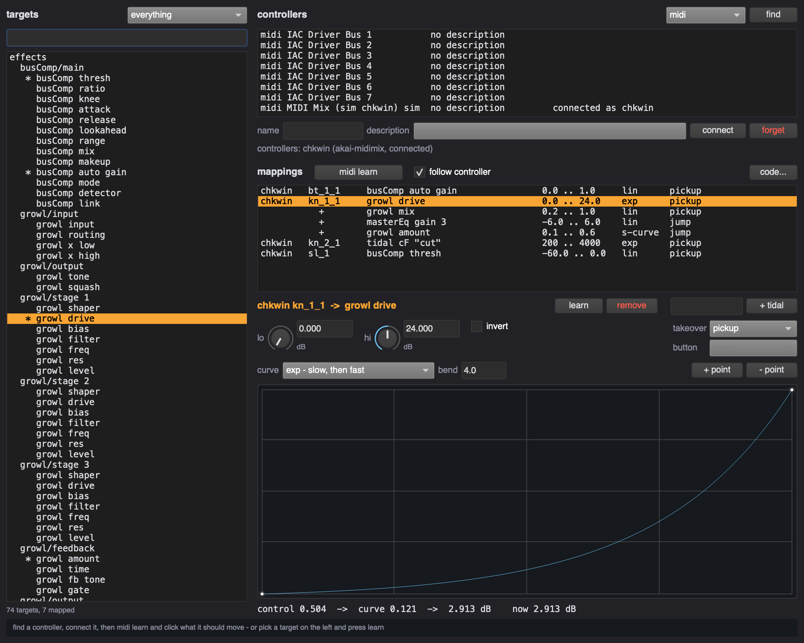

# Mapper

**One controller mapper for everything: a knob of a MIDI controller on any mixer, module or
effect, and on several of them at once.** A SuperCollider extension.

```supercollider
m = Mapper.default;                                    // the one everything shares
m.useKtl(\m1, "akai-midimix");                         // MKtl(\m1), made if it is not there
m.units.put(\eq, ParaEQ.onBus(0));                     // anything that lists its parameters
m.map(\m1, \kn_1_1, [\units, \eq, \gain3], -6, 6);     // a knob on the eq's third band
m.map(\m1, \kn_1_1, [\tidal, \bright]);                // the same knob, Tidal's cF "bright" too
m.gui;                                                 // controllers, targets, learn, every mapping
```



It depends on nothing. Controllers come through the
[Modality toolkit](https://github.com/ModalityTeam/Modality-toolkit), looked up by name: without
it there are no controllers, and Tidal mappings still work, moved from code. With
[sc-eq](https://github.com/fracnesco/sc-eq) installed, the knobs of every effect window can be
learnt by clicking them, and wear a dot while they are mapped.

Nothing that is mapped needs the mapper to compile either. A mixer, a module or a chain of
effects registers with it when it is there, and works the same when it is not.

Written for SuperCollider 3.13 on macOS.

## Install

### As a quark

```supercollider
Quarks.install("https://github.com/fracnesco/sc-mapper.git");
thisProcess.recompile;
```

### From a clone

```sh
git clone https://github.com/fracnesco/sc-mapper.git
```

Open `install.scd` in the clone and evaluate its first block, then recompile the class library
(ctrl/cmd + shift + L). It symlinks the folder into your extensions folder, so the clone stays
the single copy. `ln -s` is macOS and Linux; on Windows use the quark.

One or the other, not both: two copies on the class path is a duplicate class error at compile
time.

### Check that it took

```supercollider
Mapper.default.targets.size;     // a number, not an error
Mapper.isAvailable;              // true when Modality is installed
```

## Targets and providers

A target is something a controller can move, named by an address that stays the same across
rebuilds, reloads and sessions: `[provider, ... path]`. The first item says who owns the thing,
the rest is that owner's business.

| address | moves |
|---------|-------|
| `[\units, \eq, \gain3]` | a parameter of an effect held by name (see below) |
| `[\tidal, \bright]` | Tidal's `cF 0 "bright"`, through its port 6010 |
| `[\sdg, \fader, 0]` | SuperDirtGUI's orbit 0 fader, when SuperDirtGUI is running |
| `[\sdg, \insert, 'orbit 0', \growl, 0, \drive1]` | the first Growl insert of orbit 0, its drive |

A **provider** is whoever registers under a key and describes what it has:

```supercollider
Mapper.register(\mine, provider);
```

It answers `mapTargetAt(path)`, a description of one thing or nil, and `mapTargets`, the
descriptions of everything it has now. A description is an Event:

```supercollider
(path: [\level], label: "my level", kind: \knob, spec: ControlSpec(0, 1),
 get: { level }, set: { |v| level = v }, group: "my module")
```

`kind` is `\knob`, `\toggle` (on/off), `\trigger` (it fires) or `\menu` (the index of an item).
The mapper knows no module by name. A target whose provider is not there, or that the provider
no longer has, does not exist: setting it does nothing, and a mapping to it **waits**, and
starts working when it comes back. That is the one thing this extension has to get right:
mappings are between names, so nothing is lost when what they name is rebuilt.

### Effects by name

Anything whose class answers `mapParams` and that answers `mapGet(key)` and `mapSet(key,
value)` - every effect built on sc-eq's `FxUnit` does - can be put on the mapper under a name:

```supercollider
Mapper.units.put(\masterEq, FxChain.master.eq);
Mapper.default.targets.select { |t| t.address[1] == \masterEq }.collect(_.label);
Mapper.units.removeAt(\masterEq);
```

## Mappings

```supercollider
m.map(\m1, \sl_1, [\sdg, \fader, 0]);                          // the whole range
m.map(\m1, \kn_1_1, [\units, \eq, \freq2], 200, 2000, \exp);   // lo, hi, a curve
m.map(\m1, \bt_1_1, [\units, \eq, \lowCutOn]);                 // a button flips a switch
m.learn([\units, \eq, \gain4]);                                // the next element moved
m.unmap([\units, \eq, \gain4]);
```

**An element may move several targets, each with a range of its own. A target has one
element**: mapping a target again replaces the mapping it had.

- `lo` and `hi` are in the target's own units, along its own warp; `lo` above `hi` turns the
  control round.
- `curve` is `\lin`, `\exp`, `\log`, `\scurve`, a number (a bend) or an `Env` drawn by hand.
- `takeover: \pickup` (the default) leaves the target alone until the control reaches the value
  it has, so nothing jumps; `\jump` sets at once.
- A button on an on/off target flips it (`mode: \toggle`) or holds it while down
  (`\momentary`); on a trigger it fires. Its LED follows the target.
- A target that something else moves (it has an `owner`) refuses a mapping.

## The window

`Mapper.default.gui`. On the left, every target there is, provider by provider, narrowed by the
menu and by what you type; a star marks the mapped ones. On the right, the controllers (**find**,
**connect**, **forget**), then the mappings by control, so the targets of one knob sit together,
and under them the one on show: its range, takeover, button mode and curve.

**midi learn** switches learn mode on for every window that has something to map: click a fader
or a knob there, move a control, and again until it is off. **learn** maps the next element
moved to the target on show - a control that already moves something keeps that as well.

## Saving

The code is the storage. `Mapper.default` reads
`Platform.userAppSupportDir/sc-mapper/default.scd` the first time it is asked for, and writes it
a moment after a mapping changes.

```supercollider
m.code.postln;                // the lines that make the mappings again
m.save("~/my-maps.scd");
m.load("~/my-maps.scd");      // in place of the ones there are
Mapper.autoSave = false;      // keep the file as it is
```

A provider whose own sessions save its mappings (SuperDirtGUI does, as `midi.scd`) is left out
of that file.

## Files

| file | what it is |
|------|------------|
| [classes/Mapper.sc](classes/Mapper.sc) | the mapper: controllers, providers, mappings, learn, the code |
| [classes/MapperMap.sc](classes/MapperMap.sc) | one element moving one target: range, curve, pickup, button modes |
| [classes/MapperTarget.sc](classes/MapperTarget.sc) | something that can be moved, by address |
| [classes/MapperUnits.sc](classes/MapperUnits.sc) | the provider for effects held by name |
| [classes/MapperWindow.sc](classes/MapperWindow.sc) | the window |
| [classes/MapperHintBar.sc](classes/MapperHintBar.sc) | its hint bar |
| [install.scd](install.scd) | link, verify, unlink |
| [HelpSource/](HelpSource/Classes) | help files |

## Issues

https://github.com/fracnesco/sc-mapper/issues

## License

MIT - see [LICENSE](LICENSE).
